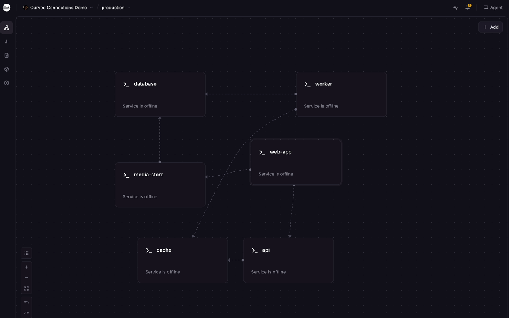

# Railway Curved Connections


A small browser extension that makes the dashed reference lines on Railway project canvases easier to follow. It draws smooth curves around service cards, separates connections that share a card edge, and puts a dot where each connection starts.



This is an independent, open-source project. It is not affiliated with Railway.

## Install in Vivaldi

1. Download the [latest release ZIP](https://github.com/christianalares/railway-curved-connections/releases/latest) and unzip it somewhere you can keep it. You can also clone this repository.
2. Open `vivaldi://extensions` and turn on **Developer mode**.
3. Click **Load unpacked** and choose the unzipped folder (the one containing `manifest.json`).
4. Open or refresh a Railway project architecture page. Use the extension button to turn the curves on or off.

In Chrome, use `chrome://extensions` for steps 2–3. Other Chromium browsers with unpacked extension support should work similarly.

To update, replace the files with a newer release, click **Reload** on the Extensions page, and refresh the Railway tab. If you cloned the repository, run `git pull` before reloading.

## What it does

The extension changes only the drawn connection paths and adds source dots on Railway project canvases. It uses the positions of the visible service cards and [Viz.js](https://viz-js.com/api/)/Graphviz to route around them. When a route cannot be calculated, it leaves Railway's original line in place.

The extension does not read variable values, call the Railway API, or send project data to another server. It stores only the on/off preference locally in your browser.

Routing depends on Railway's current page structure, which may change. Fixed card positions also mean lines can still cross in some layouts. During substantial card overlap while dragging, the extension temporarily shows Railway's own lines.

## Develop

The folder itself is an unpacked browser extension; no build step is needed for installation. To edit `content.js` or `router.js`, run:

```sh
node build.js
node --test router.test.js
```

`build.js` combines the local `viz-global.js` library and the two source files into `content-bundle.js`, which the browser loads as one content script.

## License

The extension's original code is MIT licensed; see [LICENSE](LICENSE). The bundled Viz.js is also MIT licensed; see [THIRD_PARTY_LICENSE.txt](THIRD_PARTY_LICENSE.txt) and the copyright header in `viz-global.js`.
